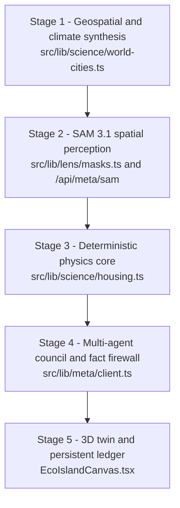
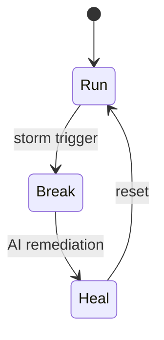

<div align="center">

# Verdara

### Spatial Climate Intelligence and Autonomous 3D Eco-District Twin

Turn any residential property or neighborhood into a scientifically grounded, interactive 3D Eco-District.<br />
Computer vision sees the site, deterministic engineering equations compute the numbers, and AI agents only explain what the physics already proved.

[](#4-ai-layer)
[](https://www.typescriptlang.org/)
[](#10-getting-started)
[](#10-getting-started)
[](#10-getting-started)
[](#10-getting-started)
[](LICENSE)

[Live Application](https://verdaraa.vercel.app/) &nbsp;|&nbsp; [Architecture](#2-system-architecture) &nbsp;|&nbsp; [Scientific Engine](#5-scientific-engine) &nbsp;|&nbsp; [Getting Started](#10-getting-started) &nbsp;|&nbsp; [Limitations](#12-assumptions-and-limitations)

</div>

---

## Table of Contents

1. [Overview](#1-overview)
2. [System Architecture](#2-system-architecture)
3. [Application Routes](#3-application-routes)
4. [AI Layer](#4-ai-layer)
5. [Scientific Engine](#5-scientific-engine)
6. [3D Digital Twin](#6-3d-digital-twin)
7. [Global Climate Coverage](#7-global-climate-coverage)
8. [Data Layer and API Reference](#8-data-layer-and-api-reference)
9. [Security](#9-security)
10. [Getting Started](#10-getting-started)
11. [Project Structure](#11-project-structure)
12. [Assumptions and Limitations](#12-assumptions-and-limitations)
13. [References and License](#13-references-and-license)

---

## 1. Overview

Climate adaptation tools tend to fail in one of two ways: they trap users in fragmented engineering spreadsheets, or they rely on generative AI that invents energy yields, water capacities, and financial returns.

**Verdara** closes that gap with a strict, one-directional paradigm:

> **Perception → Physics → Deliberation → Spatial Visualization**

| Stage | What happens | Technology |
| :--- | :--- | :--- |
| **Perception** | Rooftops, downspouts, permeable soil, and recyclable materials are extracted from a user photo. | Meta SAM 3.1 (zero-shot segmentation) |
| **Physics** | Every metric is computed with published engineering equations before any language model runs. The results are frozen into an immutable `SITE_BRIEF`. | NREL PVWatts v8, DIN 1989-1, biopore hydraulics, US EPA WARM v16 |
| **Deliberation** | Three specialist agents discuss trade-offs. A numeric firewall audits every figure they emit against the `SITE_BRIEF`. | Meta Muse Spark |
| **Visualization** | The verified retrofit is rendered as an interactive 3D district with baseline, storm, and remediation phases. | Three.js procedural geometry |

### Key Features

- **Physics first, language second.** Numbers come from deterministic TypeScript modules, never from a model.
- **Numeric fact firewall.** AI output whose figures drift more than 3.0% from the `SITE_BRIEF` is automatically corrected.
- **Global by design.** Climate normals, tariffs, currencies, and grid carbon intensity for 195+ countries or any GPS coordinate.
- **Zero-asset 3D.** The district is built from mathematical primitives, so no multi-megabyte `.glb` downloads are required.
- **Defense in depth.** Rate limiting, CSRF origin checks, payload sanitizing, and perceptual-hash anti-replay.
- **Runs out of the box.** A deterministic specimen cache lets the app work without live AI credentials.

---

## 2. System Architecture



| Stage | Responsibilities |
| :--- | :--- |
| **1. Geospatial and climate synthesis** | Resolves 195+ countries, 28 curated benchmark cities, or arbitrary GPS coordinates. Determines the Koppen-Geiger class, 12-month precipitation normals, solar irradiance (GHI), local currency, residential tariff, and grid carbon intensity. |
| **2. SAM 3.1 perception** | Computes a SHA-256 specimen hash and a 64-bit perceptual dHash. Runs zero-shot segmentation and emits polygon contours normalized to a 1000 x 1000 space, with confidence telemetry. |
| **3. Physics core** | Solves solar yield, rainwater harvesting, biopore sizing, thermal comfort, and circular-economy valuation. Locks all results into the `SITE_BRIEF` JSON payload. |
| **4. Council and firewall** | Orchestrates three specialist agents on a hosted Muse Spark API, with a local open-weight fallback. `validateNumbersAgainstSiteBrief()` audits every emitted figure. |
| **5. 3D twin and ledger** | Renders procedural PBR geometry, runs the Run / Break / Heal state machine, and syncs the Zustand store (`useVerdaraStore`) with the persistence layer. |

---

## 3. Application Routes

Verdara ships 9 primary routes. Engineering workspaces are protected by `AuthGate` (`src/components/ui/AuthGate.tsx`), which redirects unauthenticated visitors to `/login?next=<path>`.

| Route | Interface | Access | Highlights |
| :--- | :--- | :--- | :--- |
| `/` | Living Spatial Eco-Town | Public | Live 3D preview (Run, Break, Heal), draggable 10-country climate deck, 12-month ERA5 weather matrix, live GitHub stars badge. |
| `/login` | Authentication gate | Public | Supabase OAuth (Google, Facebook), email magic links, and `?next=` return redirection. |
| `/dashboard` | 3D Eco-Town Studio | Auth required | Full-viewport 3D studio, roof-area slider (40 to 600 m²), real-time solar and cistern recalculation, level 1 to 5 milestones, camera presets (Overview, Solar Hub, Hydro Canal, EV Street). |
| `/lens` | Omni-Spatial Camera Lens | Auth required | SAM 3.1 polygon visor, X-Ray wireframe overlay, before/after retrofit curtain, and downloadable 1200 x 630 PNG impact cards. |
| `/radar` | Urban Roof and Hydrology Radar | Auth required | 3D building extrusion with terrain and drainage-slope mesh. Estimates neighborhood solar irradiance, stormwater catchment, and nearby waste-bank points. |
| `/council` | 3-Specialist AI Council | Auth required | Dr. Flora, Ir. Arka, and Sirkula analyze the `SITE_BRIEF`. All figures pass the numeric firewall. |
| `/academy` | Field-Proof Academy | Auth required | Camera proof-of-action verification using SAM 3.1 and dHash anti-spoofing, replacing multiple-choice quizzes. |
| `/settings` | Shield and Preferences | Auth required | Telemetry for the 7-layer API credit shield, specimen cache, `muse-spark-open` toggle, unit system (Metric or Imperial), and language (EN or ID). |
| `/faq` | Knowledge Base | Public | 12 bilingual engineering Q&A entries with keyword search and category filters. |

---

## 4. AI Layer

Verdara integrates four capabilities from the Meta AI ecosystem (`src/lib/meta/` and `src/app/api/meta/`).

### 4.1 Meta SAM 3.1: zero-shot spatial segmentation

- **Modules:** `src/app/api/meta/sam/route.ts`, `src/lib/lens/masks.ts`, `src/components/lens/SpatialMaskViewer.tsx`
- **Mechanism:** Extracts polygon boundary contours from RGB photographs, normalized to a $1000 \times 1000$ coordinate space.

| Class | Meaning |
| :--- | :--- |
| `SOLAR_ROOF` | Unshaded pitched or flat roof planes suitable for photovoltaic mounting. |
| `RAIN_CONDUIT` | Gutters, downspouts, and impervious catchment planes for cistern routing. |
| `NATIVE_FLORA` | Permeable soil, bioswales, and tree canopy for urban heat island mitigation. |
| `RECYCLABLE_COMMODITY` | PET, HDPE, aluminum, copper, steel, cardboard, glass, and e-waste PCB. |

### 4.2 Meta Muse Spark: three-specialist council

- **Modules:** `src/app/api/meta/muse/route.ts`, `src/lib/meta/client.ts`, `src/app/council/page.tsx`

| Persona | Role | Focus |
| :--- | :--- | :--- |
| **Dr. Flora** | Urban botanist and microclimate architect | Soil permeability, native species, latent-heat cooling. |
| **Ir. Arka** | Photovoltaic and hydrological civil engineer | String sizing, tilt, first-flush diverters, cistern volume, biopore soak pits. |
| **Sirkula** | Circular economist and policy analyst | CapEx payback, utility savings, deposit-return cash recovery. |

### 4.3 Numeric fact firewall

- **Module:** `validateNumbersAgainstSiteBrief()` in `src/lib/meta/client.ts`
- **Why:** Language models can round or alter digits when writing engineering text. Every response therefore goes through a verification pass.

1. A regex extractor parses numeric tokens that carry physical units (`kWp`, `kWh`, `L`, `gal`, `m²`, `ft²`, `biopores`) and currency amounts.
2. Each token $x_{\mathrm{AI}}$ is compared with the matching physics value $x_{\mathrm{brief}}$ stored in the `SITE_BRIEF`.

$$
\delta = \frac{\lvert x_{\mathrm{AI}} - x_{\mathrm{brief}} \rvert}{x_{\mathrm{brief}}} \le 0.03
$$

3. If $\delta > 0.03$, the firewall replaces the drafted number with the exact deterministic value and logs an audit notice.

### 4.4 Meta Muse Image: generative retrofit synthesis

- **Modules:** `src/app/api/meta/image/route.ts`, `src/components/lens/SpatialMaskViewer.tsx`
- **Mechanism:** Combines SAM 3.1 polygon masks with local Koppen-Geiger parameters to generate before and after retrofit visuals, shown through a sliding curtain.

---

## 5. Scientific Engine

All physical, hydrological, and financial computations live in pure, deterministic TypeScript modules under `src/lib/science/` and are covered by unit tests in `tests/science.test.ts`.

### 5.1 Rooftop solar (NREL PVWatts v8 formulation)

Implemented in `src/lib/science/housing.ts`.

Usable array area, installed capacity, and module count:

$$
A_{\mathrm{solar}} = A_{\mathrm{roof}} \cdot f_{\mathrm{usable}}, \qquad
P_{\mathrm{kWp}} = A_{\mathrm{solar}} \cdot \rho_{\mathrm{pv}}, \qquad
N_{\mathrm{panels}} = \left\lfloor \frac{P_{\mathrm{kWp}}}{0.400} + 0.5 \right\rfloor
$$

Cell temperature and derating (simplified NOCT approach, with $T_{\max}$ as the local warm-month maximum ambient temperature):

$$
T_{\mathrm{cell}} = T_{\max} + 18.0
$$

$$
f_{\mathrm{temp}} = \min\bigl(1.02,\ \max\bigl(0.78,\ 1 - 0.0038 \cdot \max(0,\ T_{\mathrm{cell}} - 25)\bigr)\bigr)
$$

Annual energy yield and avoided emissions:

$$
E_{\mathrm{annual}} = P_{\mathrm{kWp}} \cdot \mathrm{GHI}_{\mathrm{day}} \cdot 365 \cdot \mathrm{PR} \cdot f_{\mathrm{temp}}
$$

$$
\mathrm{CO_2e}_{\mathrm{avoided}} = E_{\mathrm{annual}} \cdot EF_{\mathrm{grid}}
$$

| Parameter | Symbol | Value | Unit | Description |
| :--- | :--- | :--- | :--- | :--- |
| Usable area fraction | $f_{\mathrm{usable}}$ | `0.60` | dimensionless | Net usable roof after setbacks and pathways |
| Module power density | $\rho_{\mathrm{pv}}$ | `0.205` | kWp/m² | Based on 400 Wp monocrystalline modules |
| Temperature coefficient | $\gamma$ | `0.0038` | 1/°C | Equivalent to -0.38 %/°C above 25 °C |
| System performance ratio | $\mathrm{PR}$ | `0.80` | dimensionless | Inverter, cable, and soiling losses combined |
| Derating bounds | $f_{\mathrm{temp}}$ | `0.78` to `1.02` | dimensionless | Desert derating to cold-climate bonus |
| Grid emission factor | $EF_{\mathrm{grid}}$ | per country | kg CO₂e/kWh | Country-specific |

### 5.2 Rainwater harvesting and cistern sizing (DIN 1989-1)

Implemented in `src/lib/science/housing.ts` and `src/lib/science/climate.ts`.

$$
V_{\mathrm{harvest}} = A_{\mathrm{roof}} \cdot P_{\mathrm{annual}} \cdot C_{\mathrm{runoff}} \cdot \eta_{\mathrm{filter}}
$$

where $P_{\mathrm{annual}}$ is the 10-year mean annual precipitation in mm (equal to L/m²), $C_{\mathrm{runoff}} = 0.85$ for pitched metal or glazed tile roofs, and $\eta_{\mathrm{filter}} = 0.90$ for a first-flush vortex diverter.

The cistern is sized to roughly 31 days of annual yield (8.5 %), rounded to 500 L commercial tank increments and clamped between 1,000 L and 15,000 L:

$$
V_{\mathrm{cistern}} = \min\left(15000,\ \max\left(1000,\ 500 \cdot \left\lfloor \frac{0.085\, V_{\mathrm{harvest}}}{500} + 0.5 \right\rfloor \right)\right)
$$

### 5.3 Biopore infiltration wells and flood attenuation

Implemented in `src/lib/science/housing.ts`.

A biopore well is a vertical shaft of diameter $d = 0.10$ m and depth $h = 1.0$ m. Its percolation wall area is:

$$
A_{\mathrm{wall}} = \pi \, d \, h \approx 0.314\ \mathrm{m^2}
$$

Packed with leaf litter, each shaft is modeled with a sustained infiltration flux of about 180 L/h, even in dense urban clay.

Required well count for the region's peak rainfall month $P_{\mathrm{peak}}$ (mm), bounded between 4 and 40 shafts:

$$
N_{\mathrm{bio}} = \min\left(40,\ \max\left(4,\ \left\lceil \frac{A_{\mathrm{roof}} \cdot P_{\mathrm{peak}}}{2600} \right\rceil \right)\right)
$$

Peak storm runoff attenuation:

$$
\mathrm{Attenuation}\ (\%) = \min\bigl(92,\ 24 + \lfloor 3.8\, N_{\mathrm{bio}} + 0.5 \rfloor \bigr)
$$

### 5.4 Microclimate cooling and Thermal Comfort Index

Implemented in `src/lib/science/housing.ts`.

Surface cooling from panel shading and vegetative latent heat, where $R_{\mathrm{green}} \in [0,1]$ is the permeable vegetation ratio and $f_{\mathrm{solar}} \in [0,1]$ is the roof solar coverage fraction:

$$
\Delta T_{\mathrm{cool}} = -\bigl(0.85 + 2.40\, R_{\mathrm{green}} + 0.65\, f_{\mathrm{solar}}\bigr)
$$

Composite Thermal Comfort Index (score range 35 to 98):

$$
\mathrm{TCI} = \min\Bigl(98,\ \max\Bigl(35,\ 100 - 2.4 \cdot \max(0,\ T_{\max} - 22) + 6.0 \cdot \lvert \Delta T_{\mathrm{cool}} \rvert \Bigr)\Bigr)
$$

### 5.5 Circular economy valuation (US EPA WARM v16 and local DRS)

Implemented in `src/lib/science/circular.ts`.

$$
\mathrm{CO_2e}_{\mathrm{salvaged}} = \sum_{i=1}^{k} m_i \cdot EF_{\mathrm{warm},\,i}
\qquad
V_{\mathrm{cash}} = \sum_{i=1}^{k} m_i \cdot P_{\mathrm{drs},\,i}
$$

where $m_i$ is the mass of material $i$ in kg, and $P_{\mathrm{drs},i}$ is the local deposit-return or waste-bank unit rate.

| Material | Factor (kg CO₂e per kg) | Primary circular output |
| :--- | :--- | :--- |
| Aluminum (cans, foil) | `9.13` | Secondary ingot remelting (about 95 % energy saved) |
| E-waste (printed circuit boards) | `12.40` | Precious metal recovery (Au, Ag, Cu) |
| Copper (pipes, wiring) | `3.84` | Busbar and pipe refabrication |
| PET plastic (bottles) | `1.52` | Food-grade rPET pellets |
| HDPE plastic (jugs, containers) | `1.15` | Conduit and drainage pipe |
| Steel (structural, food cans) | `1.84` | Electric Arc Furnace rebar |
| Corrugated cardboard | `0.94` | Recycled pulp packaging |
| Container glass (bottles, jars) | `0.28` | Cullet for new containers |

> The factors above are configured constants in `circular.ts`. Verify them against the current EPA WARM release before using them for reporting.

---

## 6. 3D Digital Twin

The district (`src/components/three/EcoIslandCanvas.tsx`) is built entirely from mathematical primitives and targets 60 FPS.

**Procedural PBR geometry**

- `GrandSolarPavilion`: travertine plinth, cross-laminated timber (CLT) cantilever, glass curtain wall, monocrystalline PV arrays with busbar grids, and a home battery unit with live LED telemetry.
- `RealisticEcoHouse`: villas with parametric pitched roofs, timber portals, and gutter downspout routing.
- District infrastructure: animated-shader water canal, timber footbridge, elevated cistern tower, 12 illuminated biopore wells, recycling station, botanical dome, dual-axis wind turbines, and an autonomous EV shuttle.

**Three-phase environmental state machine**



| Phase | Behavior |
| :--- | :--- |
| **01 Run** (normal day) | Nominal solar generation, steady canal water table, gentle updraft particles, EV transit. |
| **02 Break** (storm surge) | Monsoon deluge, canal swelling, street flood surge sheet, and a roof heat-stress alert of +4.2 °C. |
| **03 Heal** (AI solution) | SAM 3.1 green scan beam, secondary solar arrays (+35 % kWp), biopore drainage activation, floodwater evacuation into the cistern. |

**Camera rig.** Frame-rate-independent interpolation (`THREE.Vector3.lerp`) provides smooth transitions between the Overview, Solar Hub, Hydro Canal, and EV Street presets while preserving orbit controls.

---

## 7. Global Climate Coverage

Implemented in `src/lib/science/world-cities.ts` and `src/lib/science/climate.ts`.

- **195+ countries indexed.** ISO-3166 resolution, national currency formatting (IDR, USD, GBP, JPY, AED, SGD, EUR, BRL, AUD, CHF, and more), residential electricity tariffs, and national grid carbon factors.
- **Koppen-Geiger synthesizer.** Given any latitude and longitude, Verdara computes 12-month precipitation and temperature distributions, classifies the biome (for example Af, Am, BWh, Csb, Cfb, Cfa, Dfb), and calibrates irradiance and cistern sizing automatically.
- **Data sources.** Open-Meteo ERA5 reanalysis for precipitation, NASA POWER for solar irradiance, and the Peel et al. (2007) classification scheme.

---

## 8. Data Layer and API Reference

### 8.1 Persistence

- **Supabase schema:** `supabase-schema.sql` at the repository root.
- **Edge-ready JSON spatial ledger:** `src/lib/db/store.ts`, with seed data.

Logical entities:

| Entity | Purpose |
| :--- | :--- |
| `UserSession` | Resident identifier, display name, email, role (`resident`, `architect`, `admin`), Eco-XP, and unlocked district level (1 to 5). |
| `SpatialScanAudit` | Timestamp, ISO jurisdiction, specimen identifier, 64-bit dHash, SAM 3.1 polygon counts, solar kWp, rainwater volume, and audit status. |
| `SecurityAuditLog` | Immutable log of rate-limit triggers, CSRF origin checks, and anti-replay rejections. |

### 8.2 REST API

| Endpoint | Method | Rate limit | Description |
| :--- | :--- | :--- | :--- |
| `/api/meta/sam` | `POST` | 30 req/min | Zero-shot segmentation through SAM 3.1, or a SHA-256 golden-cache hit in under 50 ms. |
| `/api/meta/muse` | `POST` | 30 req/min | Three-agent deliberation with automatic ±3.0 % drift auditing against the `SITE_BRIEF`. |
| `/api/meta/image` | `POST` | 20 req/min | Before and after retrofit visualization conditioned on SAM 3.1 polygons and climate biome. |
| `/api/climate` | `GET` | 60 req/min | ERA5-based or synthesized 12-month precipitation and irradiance normals for any coordinate. |
| `/api/github-stars` | `GET` | 60 req/min | Live star count with a 60-second Next.js ISR cache and a direct fallback. |
| `/api/db` | `GET`, `POST` | 60 req/min | Reads live counters, or persists user sessions and scan verification logs. |

<details>
<summary><strong>Request and response shapes</strong></summary>

```text
POST /api/meta/sam
  request : { imageBase64?: string, specimenId?: string }
  response: { polygons: PolygonMask[], dHash: string, materials: MaterialSummary }

POST /api/meta/muse
  request : { siteBrief: SiteBrief, focusArea?: string }
  response: { council: SpecialistOpinion[], audited: boolean, drift: number }

POST /api/meta/image
  request : { imageBase64: string, koppenCode: string }
  response: { originalUrl: string, retrofitUrl: string }

GET /api/climate?lat=-7.80&lng=110.36&city=Yogyakarta
  response: { koppen: KoppenData, rainMm: number[], solarGhi: number[], tariff: number }

GET /api/github-stars
  response: { stars: number, repo: string, url: string, status: string }

GET, POST /api/db
  request : query filters, or a new record as JSON
  response: { users: UserSession[], audits: SpatialScanAudit[], stats: DBStats }
```

</details>

---

## 9. Security

Controls are implemented in `src/middleware.ts`, `src/lib/security/guard.ts`, and `src/lib/security/dhash.ts`.

| Layer | Control |
| :--- | :--- |
| **Edge headers** | `X-Content-Type-Options: nosniff`, `X-Frame-Options: DENY`, `Referrer-Policy: strict-origin-when-cross-origin`, and a strict `Permissions-Policy` on all routes. |
| **Auth gate** | `/dashboard`, `/lens`, `/radar`, `/council`, `/academy`, and `/settings` redirect unauthenticated visitors to `/login?next=<path>`. |
| **Rate limiting** | Sliding-window token bucket per IP, 30 req/min on AI endpoints, answering with `HTTP 429`. |
| **Input hardening** | `Origin` and `Host` verification on mutating requests, recursive stripping of XSS vectors (`<script>`, `javascript:`, inline handlers), and removal of prototype-pollution keys (`__proto__`, `constructor`, `prototype`). |
| **Anti-replay** | 64-bit perceptual dHash on proof photos, compared by Hamming distance. |

Anti-replay works by resizing each proof photo to an $8 \times 8$ grayscale matrix and building a 64-bit hash $H$ from horizontal luminance gradients. Submissions are compared against history with:

$$
D_H(H_1, H_2) = \mathrm{popcount}(H_1 \oplus H_2)
$$

A submission with $D_H \le 8$ bits is rejected as a duplicate. This is a duplicate-detection heuristic, not proof that a photo is authentic.

---

## 10. Getting Started

### Prerequisites

- Node.js and npm (use a current LTS release)
- Git

### Installation & Developer Workflow

#### Option A: Quickstart with Makefile
```bash
# 1. Clone repository
git clone https://github.com/xFalzz/verdara.git
cd verdara

# 2. View developer targets
make help

# 3. Setup and launch local studio
make setup
make dev
make test
```

#### Option B: Production Containerization with Docker Compose
```bash
# 1. Launch Next.js web application + Python climate eval microservice + Redis
docker compose up -d

# 2. View container logs
docker compose logs -f

# 3. Verify healthcheck endpoints
curl -f http://localhost:3000/api/health
curl -f http://localhost:8000/health
```

#### Option C: Python Meta AI Quantitative Evaluation & LoRA Training
```bash
# 1. Run SAM 3.1 segmentation benchmark (mIoU, BF1, latency)
python -m eval.benchmark_sam_metrics

# 2. Run Muse Spark reasoning benchmark
python -m eval.benchmark_muse_reasoning

# 3. Execute open-weights QLoRA fine-tuning distillation pipeline
python -m eval.finetune_lora_muse_spark
```

### Configuration

The app runs out of the box on the deterministic specimen cache. To enable live AI calls and authentication, fill in the variables listed in [`.env.example`](.env.example) inside `.env.local`. Never commit `.env.local`.

### Deployment

The repository includes a [`netlify.toml`](netlify.toml) for Netlify. The production deployment is available at [verdaraa.vercel.app](https://verdaraa.vercel.app/).

---

## 11. Project Structure

```text
verdara/
├── .agents/skills/              # Agent skill definitions
├── src/
│   ├── app/
│   │   ├── academy/page.tsx     # Field-proof camera verification academy
│   │   ├── api/                 # Route handlers: meta (sam, muse, image), climate, db, github-stars
│   │   ├── council/page.tsx     # 3-specialist AI council
│   │   ├── dashboard/page.tsx   # 3D Eco-Town studio
│   │   ├── docs/page.tsx        # Interactive documentation
│   │   ├── faq/page.tsx         # Searchable knowledge base
│   │   ├── lens/page.tsx        # Camera lens and retrofit curtain
│   │   ├── login/page.tsx       # Authentication and demo sandbox
│   │   ├── radar/page.tsx       # 3D urban roof and hydrology radar
│   │   ├── settings/page.tsx    # Credit shield and preferences
│   │   ├── globals.css          # Design tokens and layout styling
│   │   ├── layout.tsx           # Root layout, fonts, smooth scroll
│   │   └── page.tsx             # Landing page
│   ├── components/
│   │   ├── lens/                # SpatialMaskViewer
│   │   ├── three/               # EcoIslandCanvas
│   │   └── ui/                  # AuthGate, Navbar, Dock, SmoothScroll, InteractiveEffects
│   ├── lib/
│   │   ├── db/                  # Data store and seed data
│   │   ├── lens/                # Specimen masks and polygon normalizers
│   │   ├── meta/                # Meta AI client, fact validator, credit shield
│   │   ├── science/             # PVWatts, DIN 1989-1, biopores, climate, circular economy, units
│   │   └── security/            # Rate limiter, sanitizer, dHash engine
│   ├── store/
│   │   └── useVerdaraStore.ts   # Persisted Zustand store
│   └── middleware.ts            # Edge security headers
├── tests/
│   ├── science.test.ts          # Physics and hydrology unit tests
│   └── security.test.ts         # Rate limiter, sanitizer, dHash unit tests
├── supabase-schema.sql          # Database schema
├── DESIGN.md                    # Design system notes
├── netlify.toml                 # Deployment configuration
├── next.config.ts
├── tsconfig.json
└── .env.example
```

---

## 12. Assumptions and Limitations

Verdara is a **pre-feasibility estimation tool**. It is not a substitute for a site survey or a licensed engineering design.

- **Simplified models.** Solar yield uses a fixed performance ratio and a simplified cell-temperature model. Roof tilt, azimuth, and shading are not modeled in detail.
- **Empirical constants.** Biopore sizing and runoff attenuation use fixed empirical constants, not site-specific soil tests.
- **Perception quality.** Segmentation results depend on photo quality, angle, and lighting. Polygon areas are not metric measurements unless the roof area is confirmed by the user.
- **Reference data.** Tariffs, emission factors, and recycling rates are configured values and change over time. Validate them before using results for reporting or financial decisions.
- **Firewall scope.** The numeric firewall guards figures that carry recognized units. It does not verify qualitative claims in AI-written text.
- **Anti-replay.** Perceptual hashing detects near-duplicate photos only.

---

## 13. References and License

**Author:** Nawfal Irfan ([@xFalzz](https://github.com/xFalzz)), lead architect and developer.

**Context:** Built for the Meta Global AI Hackathon 2026 (spatial perception, sustainability, and autonomous multi-agent systems).

**References**

- NREL PVWatts v8 rooftop photovoltaic derating model, National Renewable Energy Laboratory, US Department of Energy.
- DIN 1989-1: *Rainwater Harvesting Systems*, Deutsches Institut fuer Normung.
- Kamir R. Brata: *Biopore Infiltration Holes for Sustainable Stormwater Management*, IPB University.
- Peel, M. C., Finlayson, B. L., and McMahon, T. A. (2007). *Updated world map of the Koppen-Geiger climate classification*. Hydrology and Earth System Sciences.
- US EPA WARM v16: *Waste Reduction Model for Greenhouse Gas Life-Cycle Assessment*, US Environmental Protection Agency.

**License:** Released under the [MIT License](LICENSE).

<div align="center">

If Verdara is useful to you, consider giving the repository a star.

</div>
