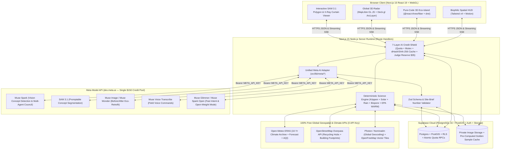

# 2. TRD — Technical Requirement Documentation
**Project Name:** Verdara (*Spatial Intelligence for Sustainable Living & Resilient Homes*)  
**Version:** 3.0 (Final Pre-Build Lock — Unified Meta Model API + Pure Procedural 3D)  
**Date:** October 28, 2026

---

## 1. Arsitektur Sistem Tingkat Tinggi (System Architecture)

Verdara dibangun sebagai aplikasi **Single-Repo Full-Stack TypeScript** di atas **Next.js 15 (App Router)** dengan pemisahan tegas antara **3D/Spatial Client Layer**, **Deterministic Environmental Science Engine**, **Unified Meta AI Gateway (7-Layer Credit Shield)**, dan **Supabase PostgreSQL + PostGIS Persistence Layer**.



---

## 2. Spesifikasi Tech Stack & Library (Exact Versions & Roles)

| Lapisan | Paket / Teknologi | Versi Target | Alasan Teknis & Peran Spesifik |
| :--- | :--- | :---: | :--- |
| **Framework** | `next`, `react`, `react-dom` | `^15.1.0` / `^19.0.0` | App Router, Server Components, Streaming SSE Route Handlers (`runtime = "nodejs"`). |
| **Language** | `typescript` | `^5.7.0` | `strict: true`, `noUncheckedIndexedAccess: true` untuk mencegah bug runtime. |
| **Styling & Motion** | `tailwindcss`, `motion`, `lucide-react` | `^4.0.0` / `^12.0.0` | Sistem token CSS variabel *Botanical Daylight* & *Bioluminescent Canopy*, animasi transisi & X-Ray slider. |
| **3D Procedural Island** | `three`, `@react-three/fiber`, `@react-three/drei` | `^0.172.0` / `^9.0.0` | **100% Pure-Code 3D Island** (geometri prosedural tanpa Blender/file `.glb`), kamera orbit, langit siang/malam, & label `<Html />`. |
| **3D Geospatial Map** | `maplibre-gl`, `@deck.gl/core`, `@deck.gl/layers`, `@turf/area`, `@turf/distance`, `suncalc` | `^5.0.0` / `^9.1.0` | Peta dunia vektor gratis (`OpenFreeMap`), ekstrusi bangunan 3D (`pitch: 55°`), busur rute 3D (`ArcLayer`), dan kalkulasi luas poligon atap. |
| **State & i18n** | `zustand`, `next-intl`, `zod` | `^5.0.0` / `^3.26.0` / `^3.24.0` | Sinkronisasi `GeoContext` ke kanvas 3D, bilingual instan (`EN`/`ID`), dan validasi skema JSON AI. |
| **Image & Perceptual Hash** | `sharp`, `file-type` | `^0.33.5` / `^20.0.0` | Kompresi gambar ke `1280 px`, penghapusan EXIF GPS, validasi *magic bytes*, dan kalkulasi **64-bit `dHash`** anti-duplikat. |
| **Database & Auth** | `@supabase/supabase-js`, `@supabase/ssr` | `^2.48.0` / `^0.5.2` | Autentikasi cookie SSR, query PostGIS, dan manajemen akun ephemeral juri. |
| **Testing** | `vitest`, `@playwright/test`, `@axe-core/playwright` | `^3.0.0` / `^1.50.0` | Unit test rumus sains deterministik, E2E test alur juri, dan audit aksesibilitas WCAG 2.2 AA. |

---

## 3. Spesifikasi Unified Meta Model API (`src/lib/meta/*`)

Seluruh fitur AI dipanggil menggunakan **satu kunci resmi `META_API_KEY`** terhadap endpoint `META_API_BASE_URL` (`https://api.meta.ai/v1`).

### 3.1 Tabel Konfigurasi Model Meta
| Variabel Env | Default Model ID | Operasi di Verdara | Batas Token / Input | Estimasi Biaya / Call |
| :--- | :--- | :--- | :--- | :---: |
| `META_MODEL_SPARK` | `muse-spark` | `DETECT_WASTE`, `ENRICH_MATERIALS`, `COUNCIL_AGENT`, `SYNTHESIZE_BLUEPRINT` | Input gambar $\le 1280\text{ px}$; `max_tokens`: `300–800` | $\sim \$0.004 - \$0.015$ |
| `META_MODEL_SAM` | `sam-3-1` | `SAM_SEGMENT_CONCEPT` (Lens & Academy Proof-of-Action) | Maks. **5 konsep/scan** di Lens; maks. **3 konsep/proof** di Academy | $\sim \$0.0025 \times N_{\text{konsep}}$ |
| `META_MODEL_IMAGE` | `muse-image` (atau `muse-wonder`) | `GENERATE_ECO_RETROFIT` (Before/After Architectural Visualization) | Prompt arsitektur berbasis biome Köppen + geometri mask SAM 3.1 | $\sim \$0.010 - \$0.020$ |
| `META_MODEL_VOICE` | `muse-voice-transcribe` | `TRANSCRIBE_VOICE_COMMAND` (Perintah suara di Lens & Radar) | Audio WebM/WAV $\le 15\text{ detik}$ ($\le 1.5\text{ MB}$) | $\sim \$0.002$ |
| `META_MODEL_OPEN` | `muse-spark-open` / `muse-glimmer` | `COUNCIL_OPEN_WEIGHT_MODE` & `FAST_INTENT_CLASSIFIER` | `max_tokens`: `350` | $\sim \$0.002$ |

### 3.2 Algoritma Normalisasi Mask SAM 3.1, IoU & Deduplikasi (`src/lib/lens/masks.ts`)

1. **Normalisasi Koordinat (`[0..1]`)**:
   Setiap poligon mask dari **SAM 3.1** dinormalisasi terhadap lebar $W$ dan tinggi $H$ gambar (`x_norm = x / W`, `y_norm = y / H`), disederhanakan dengan algoritma **Ramer–Douglas–Peucker** ($\varepsilon = 0.003$, maks. 64 titik per poligon) agar render SVG berjalan `60 FPS`.
2. **Rasio Luas Piksel (`areaRatio`)**:
   $$\text{areaRatio} = \frac{\text{Jumlah Piksel Mask } (M = 1)}{W \times H}$$
   Konsep dengan $\text{score} < 0.45$ atau $\text{areaRatio} < 0.002$ ($< 0.2\%$ luas foto) dibuang sebagai *noise*.
3. **Deduplikasi Intersection-over-Union (IoU)**:
   Jika dua instance mask $A$ dan $B$ memiliki:
   $$\text{IoU}(A, B) = \frac{|A \cap B|}{|A \cup B|} \ge 0.85$$
   maka hanya instance dengan $\text{score}$ tertinggi yang dipertahankan. Maksimal objek akhir per scan adalah **15 instance**.

---

## 4. Spesifikasi Mesin Sains & Matematika Deterministik (`src/lib/science/*`)

> [!IMPORTANT]
> **Prinsip Anti-AI-Slop**: Tidak ada satu pun angka uang, kWh surya, liter air hujan, jumlah biopori, atau gram $\text{CO}_2\text{e}$ yang boleh dikarang oleh LLM. Seluruh angka wajib dihitung oleh fungsi TypeScript murni di bawah ini dan diuji dengan Vitest.

### 4.1 Klasifikasi Iklim Köppen–Geiger (Peel et al., 2007)
Dihitung dari data bulanan 10 tahun Open-Meteo ERA5 ($T_1 \dots T_{12}$ dalam $^\circ\text{C}$ dan $P_1 \dots P_{12}$ dalam $\text{mm}$):
* $T_{\text{hot}} = \max(T_m)$, $T_{\text{cold}} = \min(T_m)$, $T_{\text{ann}} = \frac{1}{12}\sum T_m$, $P_{\text{ann}} = \sum P_m$, $T_{\text{mon10}} = \text{jumlah bulan dengan } T_m > 10^\circ\text{C}$.
* Enam bulan musim panas (Apr–Sep untuk $\text{lat} \ge 0$; Okt–Mar untuk $\text{lat} < 0$) dan enam bulan musim dingin ditentukan untuk menghitung ambang kekeringan $P_{\text{thresh}}$:
  $$P_{\text{thresh}} = \begin{cases} 2 \cdot T_{\text{ann}} + 28 & \text{jika } \ge 70\% \text{ curah hujan jatuh di musim panas} \\ 2 \cdot T_{\text{ann}} & \text{jika } \ge 70\% \text{ curah hujan jatuh di musim dingin} \\ 2 \cdot T_{\text{ann}} + 14 & \text{lainnya} \end{cases}$$
* Urutan evaluasi: **Grup E (Polar)** jika $T_{\text{hot}} < 10$ $\rightarrow$ **Grup B (Arid)** jika $P_{\text{ann}} < 10 \cdot P_{\text{thresh}}$ (`BWh`/`BWk`/`BSh`/`BSk`) $\rightarrow$ **Grup A (Tropical)** jika $T_{\text{cold}} \ge 18$ (`Af`/`Am`/`Aw`) $\rightarrow$ **Grup C (Temperate)** jika $0 < T_{\text{cold}} < 18$ (`Csa`/`Csb`/`Cfa`/`Cfb`) $\rightarrow$ **Grup D (Continental)** jika $T_{\text{cold}} \le 0$.

### 4.2 Rumus Kalkulator Atap & Hunian (`src/lib/science/calculator.ts`)
Diberikan luas atap $A_{\text{roof}}$ ($\text{m}^2$), radiasi surya harian rata-rata $\text{GHI}$ ($\text{kWh/m}^2/\text{hari}$ dari ERA5), dan curah hujan tahunan $P_{\text{ann}}$ ($\text{mm/tahun}$):

1. **Kapasitas & Produksi Panel Surya (NREL PVWatts Simplified)**:
   $$\text{kWp} = A_{\text{roof}} \times f_{\text{roof}} \times \eta_{\text{panel}}$$
   $$\text{kWh}_{\text{year}} = \text{kWp} \times \text{GHI} \times 365 \times \text{PR}$$
   $$\text{Savings}_{\text{year}} = \text{kWh}_{\text{year}} \times \text{Tariff}_{\text{local}}, \qquad \text{CO}_{2\text{e,solar}} = \text{kWh}_{\text{year}} \times \text{EF}_{\text{grid}}$$
   *(Default yang dapat diedit pengguna: rasio atap layak $f_{\text{roof}} = 0.60$, kepadatan daya panel $\eta_{\text{panel}} = 0.20\text{ kWp/m}^2$, Performance Ratio $\text{PR} = 0.78$).*

2. **Potensi Panen Air Hujan Tahunan ($1\text{ mm} \times 1\text{ m}^2 = 1\text{ Liter}$)**:
   $$\text{Rain}_{\text{liters/year}} = A_{\text{roof}} \times P_{\text{ann}} \times C_{\text{runoff}} \times \eta_{\text{filter}}$$
   *(Default: koefisien limpasan atap $C_{\text{runoff}} = 0.85$, efisiensi saringan pertama $\eta_{\text{filter}} = 0.90$).*

3. **Kebutuhan Lubang Resapan Biopori / Infiltrasi**:
   $$N_{\text{biopore}} = \left\lceil \frac{A_{\text{roof}} \times C_{\text{runoff}}}{12} \right\rceil$$

4. **Thermal Comfort Index (TCI — Skor Heuristik `0–100`)**:
   $$\text{TCI} = \text{clamp}_{[0, 100]}\!\left(\text{round}\!\left(85 - 2.2 \cdot \max(0, T_{\text{warm}} - 24) + 25 \cdot r_{\text{green}} - 18 \cdot r_{\text{built}}\right)\right)$$

**Tabel Referensi Golden Unit Test (Wajib Lulus di Vitest):**
* Input: $A_{\text{roof}} = 120\text{ m}^2$, $\text{GHI} = 5.20\text{ kWh/m}^2/\text{d}$, $P_{\text{ann}} = 2100\text{ mm}$, $\text{Tariff} = 1445\text{ IDR/kWh}$, $\text{EF}_{\text{grid}} = 0.78\text{ kg/kWh}$, $T_{\text{warm}} = 31^\circ\text{C}$, $r_{\text{green}} = 0.25$, $r_{\text{built}} = 0.55$:
  * $\text{kWp} = \mathbf{14.40\text{ kWp}}$
  * $\text{kWh}_{\text{year}} = \mathbf{21,316.03\text{ kWh/yr}}$
  * $\text{Savings}_{\text{year}} = \mathbf{30,801,666\text{ IDR/yr}}$
  * $\text{Rain}_{\text{liters/year}} = \mathbf{192,780\text{ L/yr}}$
  * $N_{\text{biopore}} = \mathbf{9\text{ unit}}$
  * $\text{TCI} = \mathbf{66 / 100}$

---

## 5. Spesifikasi Pure-Code 3D Engine (100% Tanpa Blender)

Untuk menjamin kecepatan *build*, ukuran bundle minimal, dan interaktivitas data 100%, komponen `<EcoIslandCanvas />` dibangun murni menggunakan komposisi komponen prosedural `@react-three/fiber`:

| Elemen Pulau 3D | Geometri Three.js Prosedural | Reaksi Dinamis Terhadap State Pengguna |
| :--- | :--- | :--- |
| **Pulau Dasar Berlapis** | `CylinderGeometry(6, 5.2, 1.4, 6)` (heksagonal bertingkat) + cincin air transparan | Warna lapisan atas berubah otomatis mengikuti `biome` Köppen (`#2D6A4F` tropis, `#D4A373` arid, `#52796F` temperate, `#E0FBFC` polar). |
| **Rumah Inti & Atap** | Grup `BoxGeometry` + `ConeGeometry` / `Prism` dengan jendela bercahaya (`emissive`) | Jendela menyala hangat (`#F59E0B`) saat lokasi pengguna berada di malam hari (`isNight = true`). |
| **Panel Surya Atap (Lv. 6)** | Array `BoxGeometry(0.6, 0.04, 0.9)` miring $30^\circ$ dengan material `metalness: 0.85, roughness: 0.15` | Muncul saat `level >= 6` atau setelah simulasi surya disimpan; menampilkan *Floating Pill* kapasitas `kWp`. |
| **Tong Air Hujan & Biopori (Lv. 5)** | `CylinderGeometry` biru-hijau di samping talang atap + cincin infiltrasi tanah | Muncul saat `level >= 5` atau track *Rainwater* terverifikasi. |
| **Vegetasi & Pohon Kanopi** | Instanced `ConeGeometry` (konifer/cemara), `IcosahedronGeometry` (kanopi pohon rindang), atau silinder melengkung (palem) | Jumlah pohon bertambah dari 2 pohon (Lv. 3) hingga hutan kanopi penuh (Lv. 10) dengan animasi goyangan angin (`useFrame` sinus wave). |
| **Turbin Angin Mikro (Lv. 9)** | Tiang `CylinderGeometry` + 3 bilah baling-baling yang berputar di `useFrame` | Kecepatan putar baling-baling mengikuti kecepatan angin aktual dari Open-Meteo. |

---

## 6. Spesifikasi 7-Layer AI Credit Shield & Keamanan (`src/lib/meta/shield.ts`)

```ts
export interface ShieldConfig {
  dailyBudgetUsd: number;        // Default: $12.00/day
  lifetimeCapUsd: number;        // Default: $135.00 (dari $150 kredit gratis; Spend Limit Meta = $140.00)
  judgeReserveUsd: number;       // Default: $35.00 (dikunci eksklusif untuk is_judge_demo = true)
  publicCapUsd: number;          // Otomatis: $100.00 ($135 - $35)
}
```

1. **Urutan Eksekusi Pre-Flight (`callMetaWithShield`)**:
   * **Step 1 (Cache Check)**: Hitung `image_sha256` dan 64-bit `dHash`. Jika cocok dengan entri di `ai_cache` (termasuk 6 sampel Golden Demo), kembalikan hasil dalam `< 50 ms` dengan `costUsd: 0` dan `cache: "hit"`.
   * **Step 2 (Auth & Anti-Bot Check)**: Pastikan sesi Supabase aktif (`auth.uid()`), header `Origin` cocok, dan User-Agent bukan bot otomatis.
   * **Step 3 (Concurrency Lock & IP Burst Limit)**: Panggil fungsi SQL atomik `acquire_ai_slot(user_id, ip_hash, op)`. Tolak dengan HTTP 429 jika ada stream yang masih berjalan atau jika IP melebihi `6 req/menit`.
   * **Step 4 (Budget & Judge Reserve Check)**:
     * Jika `total_spend >= $135.00` $\rightarrow$ aktifkan *Eco-Saver Cache Fallback*.
     * Jika `!user.is_judge_demo` dan `total_spend >= $100.00` $\rightarrow$ aktifkan *Eco-Saver Cache Fallback* untuk publik, sehingga **\$35.00 terakhir tetap utuh 100% untuk Juri Hackathon**.
   * **Step 5 (Execute & Log)**: Jalankan panggilan ke Meta Model API dengan `AbortController` timeout (`25s` untuk Vision/SAM, `45s` untuk Council/Image), catat biaya aktual ke tabel `ai_usage`, dan lepaskan *concurrency slot*.
