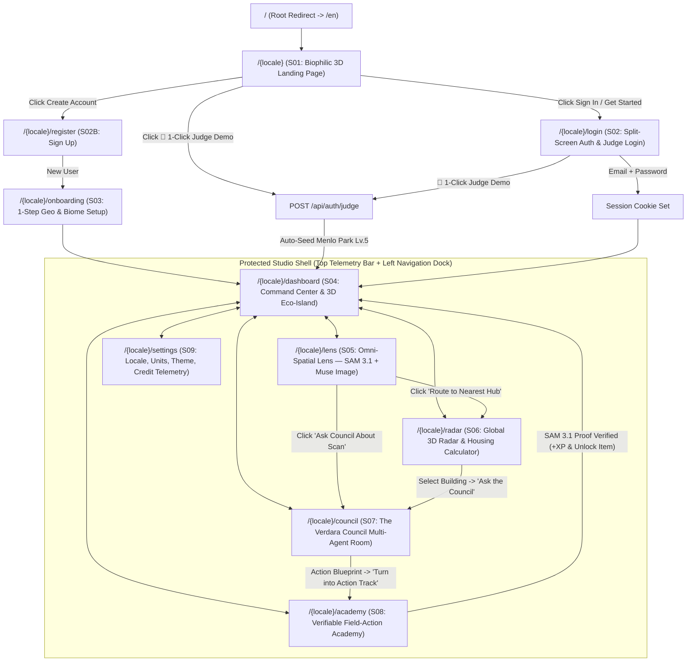
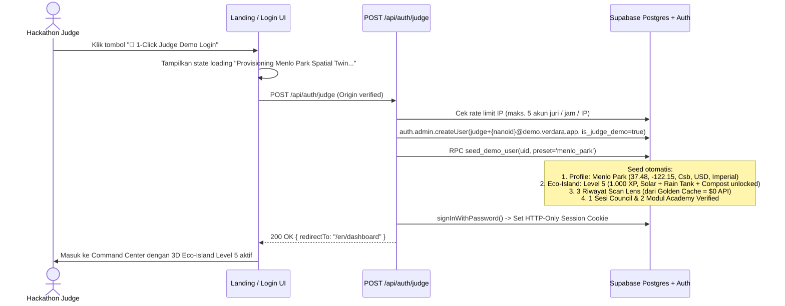
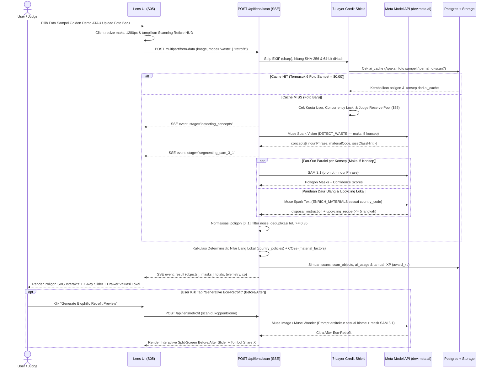
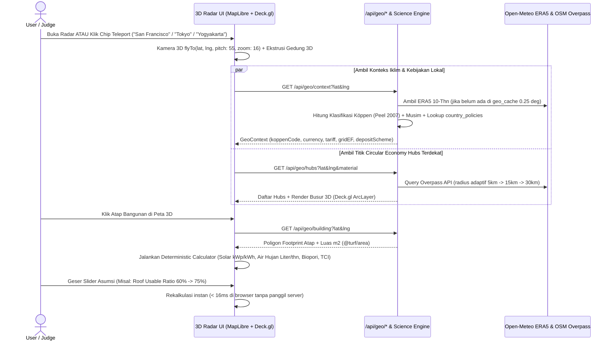
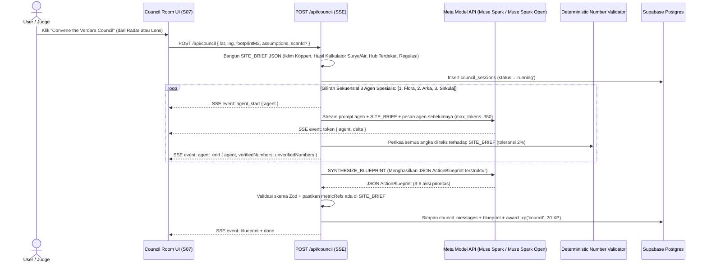
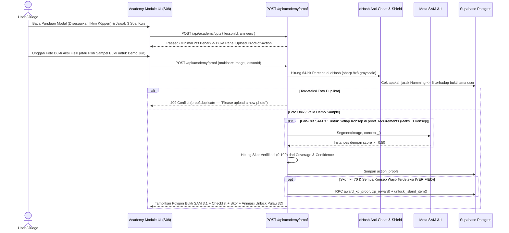
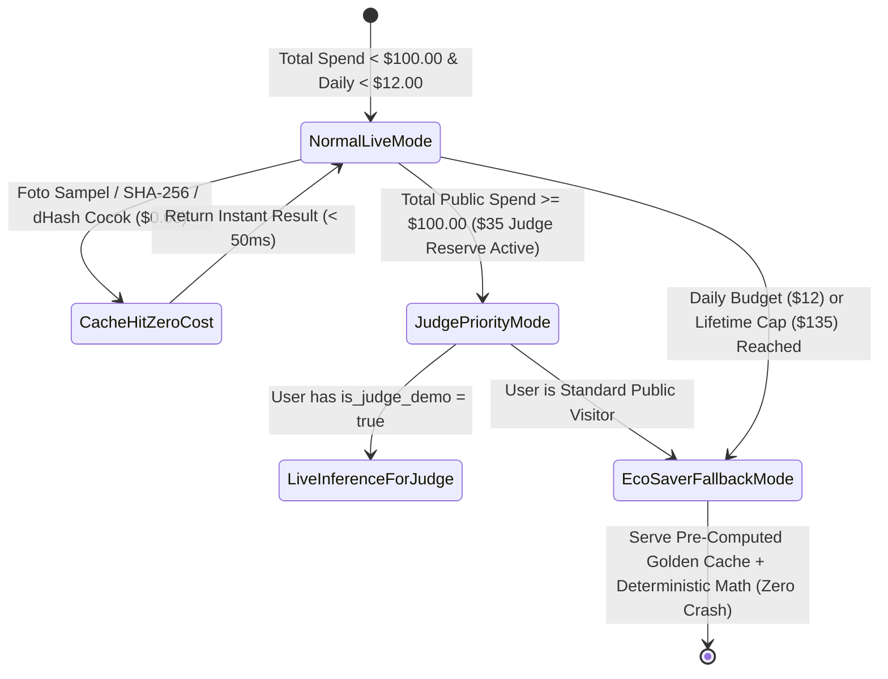

# 3. AFD — App Flow Documentation
**Project Name:** Verdara (*Spatial Intelligence for Sustainable Living & Resilient Homes*)  
**Version:** 3.0 (Final Pre-Build Lock)  
**Date:** October 28, 2026

---

## 1. Peta Navigasi Global & Arsitektur Route (Sitemap)

Seluruh halaman menggunakan prefix bahasa `/{locale}` (`en` default atau `id`) dan dipisahkan menjadi **Public Marketing Routes** dan **Protected Studio Routes (Wajib Sesi Auth / 1-Click Judge Login)**.

---

## 2. Matriks Route Guard & State Akses

| Route Path | Status Auth | Jika Belum Login | Jika Sudah Login (Belum Onboarding) | Jika Sudah Login & Onboarding (atau Akun Juri) |
| :--- | :---: | :--- | :--- | :--- |
| `/{locale}` | Publik | Render Landing Page (`S01`) | Render Landing Page + tombol *"Go to Dashboard"* | Render Landing Page + tombol *"Open Studio"* |
| `/{locale}/login` & `/register` | Publik | Render Form Auth + **1-Click Judge Login** | Redirect `307` ke `/{locale}/onboarding` | Redirect `307` ke `/{locale}/dashboard` |
| `/{locale}/onboarding` | Wajib Auth | Redirect `307` ke `/{locale}/login` | Render Pemilihan Lokasi & Iklim (`S03`) | Redirect `307` ke `/{locale}/dashboard` |
| `/{locale}/dashboard` | Wajib Auth | Redirect `307` ke `/{locale}/login?next=/dashboard` | Redirect `307` ke `/{locale}/onboarding` | Render Command Center + 3D Eco-Island (`S04`) |
| `/{locale}/lens` | Wajib Auth | Redirect `307` ke `/{locale}/login?next=/lens` | Redirect `307` ke `/{locale}/onboarding` | Render Omni-Spatial Lens (`S05`) |
| `/{locale}/radar` | Wajib Auth | Redirect `307` ke `/{locale}/login?next=/radar` | Redirect `307` ke `/{locale}/onboarding` | Render Global 3D Radar & Calculator (`S06`) |
| `/{locale}/council` | Wajib Auth | Redirect `307` ke `/{locale}/login?next=/council` | Redirect `307` ke `/{locale}/onboarding` | Render Multi-Agent Council (`S07`) |
| `/{locale}/academy` | Wajib Auth | Redirect `307` ke `/{locale}/login?next=/academy` | Redirect `307` ke `/{locale}/onboarding` | Render Field-Action Academy (`S08`) |

---

## 3. Alur Detail 6 Perjalanan Utama (End-to-End Sequence Flows)

### 3.1 Flow 1 — `🔑 1-Click Judge Demo Login` (Zero-Friction Judge Entry `< 3 Detik`)

Dirancang khusus agar Juri Hackathon dapat masuk ke dalam Studio yang sudah terisi data kaya (*Menlo Park, California — Level 5*) dalam satu klik.

---

### 3.2 Flow 2 — `Omni-Spatial Lens`: Waste Valuation + Generative Eco-Retrofit (`Muse Spark` + `SAM 3.1` + `Muse Image`)

---

### 3.3 Flow 3 — `Global 3D Radar & Deterministic Housing Calculator` (`S06`)

---

### 3.4 Flow 4 — `The Verdara Council`: Multi-Agent Simulation & Blueprint Synthesis (`S07`)

---

### 3.5 Flow 5 — `Verifiable Field-Action Academy`: SAM 3.1 Proof-of-Action (`S08`)

---

## 4. Diagram State Machine — Siklus Hidup Kredit AI & Mode Fallback

