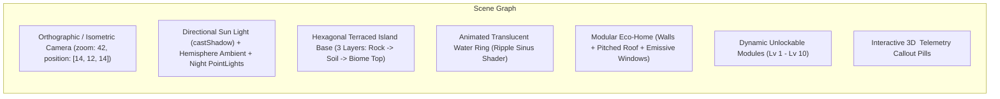

# 4. DBD — Design Brief Documentation
**Project Name:** Verdara (*Spatial Intelligence for Sustainable Living & Resilient Homes*)  
**Aesthetic Direction:** **Biophilic Spatial HUD** (*Editorial Botanical Daylight × Precision Geospatial Telemetry*)  
**Version:** 3.0 (Final Pre-Build Lock — 100% Anti-AI-Slop & Pure-Code 3D)  
**Date:** October 28, 2026

---

## 1. Filosofi Desain & Aturan Keras Anti-AI-Slop

Verdara menggabungkan dua dunia visual yang kontras namun harmonis: **keanggunan editorial arsitektur organik** (*Chartogne-Taillet*, *Architectural Digest*) dan **ketajaman instrumen telemetri spasial** (*Linear*, *Google Solar API 3D*, *Meta SAM Visor*).

### 🚫 7 Larangan Mutlak (Anti-AI-Slop Visual Rules)
1. **DILARANG** menggunakan gradien ungu/biru/magenta neon (`#8B5CF6` $\rightarrow$ `#EC4899`) khas template AI generik.
2. **DILARANG** menggunakan angka metrik palsu yang dikarang di UI (seperti `"99.4% Accuracy"` atau `"+142% Efficiency"`). Semua angka wajib memiliki satuan fisik (`kg CO₂e`, `kWp`, `L/yr`, `ms`) dan sumber data.
3. **DILARANG** membuat halaman *chat bubble* generik seperti klon ChatGPT. **The Verdara Council** tampil sebagai **Spatial Engineering Briefing Table** dengan 3 kartu spesialis berdampingan dan matriks *Action Blueprint*.
4. **DILARANG** menggunakan bayangan tebal keruh (`box-shadow` besar berwarna hitam pekat). Gunakan *hairline border* `1px solid` dan *frosted glass* halus (`backdrop-filter: blur(16px)`).
5. **DILARANG** menampilkan angka yang melompat-lompat lebarnya saat berubah; seluruh angka wajib menggunakan `font-variant-numeric: tabular-nums`.
6. **DILARANG** memakai gambar stok manusia tersenyum memegang tanaman. Gunakan kanvas **3D Eco-Island interaktif**, peta **3D Bangunan nyata**, dan **poligon segmentasi SAM 3.1**.
7. **DILARANG** mengunci pengguna dalam animasi *scroll-jacking* yang lambat; seluruh fitur utama di Studio harus dapat dijangkau dalam **1 klik** dari *Left Navigation Dock*.

---

## 2. Sistem Palet Warna Dual-Theme (WCAG 2.2 AA Compliant)

Verdara memiliki dua tema kelas satu yang dapat diganti secara instan atau mengikuti siklus matahari di kota aktif pengguna:

### 2.1 Light Theme — *Botanical Daylight* (Default untuk Landing Page & Siang Hari)
Terinspirasi dari kertas batu hangat (*Alabaster Stone*), dedaunan hutan tua, dan terakota tanah liat.

| Token CSS | Hex Value | Penggunaan Spesifik | Rasio Kontras |
| :--- | :---: | :--- | :---: |
| `--bg-canvas` | `#F6F5F0` | Latar belakang utama aplikasi (*Warm Alabaster Stone*) | — |
| `--bg-surface` | `#FFFFFF` | Permukaan kartu utama & panel kalkulator | — |
| `--bg-elevated` | `#ECEAE2` | Permukaan sekunder, chip filter, & header tabel | — |
| `--bg-glass` | `rgba(246, 245, 240, 0.82)` | Floating HUD Dock & Telemetry Bar (`backdrop-blur-md`) | — |
| `--text-primary` | `#111C16` | Judul & teks utama (*Deep Forest Obsidian*) | `15.4 : 1` (AAA) |
| `--text-secondary` | `#3D5245` | Label sekunder, deskripsi, & sitasi sumber | `7.6 : 1` (AAA) |
| `--text-muted` | `#5E7466` | Caption, timestamp, & metadata | `4.7 : 1` (AA) |
| `--accent-primary` | `#14532D` | Tombol utama, tautan aktif, & badge utama (*Botanical Pine*) | `8.9 : 1` (AAA) |
| `--accent-highlight` | `#65A30D` | Sorotan progres, indikator positif, & poligon *Recyclable* | `4.5 : 1` (AA) |
| `--accent-amber` | `#B45309` | Indikator energi surya (`kWp`) & peringatan (*Solar Terracotta*) | `5.1 : 1` (AA) |
| `--accent-cyan` | `#0E7490` | Indikator air hujan (`L/yr`) & hidrologi (*Hydro Teal*) | `5.4 : 1` (AA) |
| `--border-subtle` | `#DCD9CE` | Garis pembatas `1px` antar kartu dan grid | — |

### 2.2 Dark Theme — *Bioluminescent Canopy* (Default untuk Studio Malam & 3D Radar)
Terinspirasi dari kanopi hutan malam dengan aksen hijau *bioluminescent* dan *solar gold*.

| Token CSS | Hex Value | Penggunaan Spesifik | Rasio Kontras |
| :--- | :---: | :--- | :---: |
| `--bg-canvas` | `#08100C` | Latar belakang kanvas 3D malam (*Deep Canopy Night*) | — |
| `--bg-surface` | `#0F1C15` | Permukaan kartu utama & drawer samping | — |
| `--bg-elevated` | `#16291F` | Hover state, input field, & kartu sekunder | — |
| `--bg-glass` | `rgba(15, 28, 21, 0.78)` | Floating HUD & overlay di atas peta/pulau 3D | — |
| `--text-primary` | `#ECFDF5` | Teks utama (*Crisp Mint White*) | `16.8 : 1` (AAA) |
| `--text-secondary` | `#A7F3D0` | Subjudul & metrik sekunder (*Soft Sage*) | `11.2 : 1` (AAA) |
| `--text-muted` | `#6EE7B7` | Label telemetri & metadata | `8.1 : 1` (AAA) |
| `--accent-primary` | `#A3E635` | Tombol utama, poligon aktif SAM 3.1, & XP glow (*Bioluminescent Lime*) | `11.4 : 1` (pada `#08100C`) |
| `--accent-amber` | `#F59E0B` | Metrik energi surya & tombol **1-Click Judge Demo** | `8.6 : 1` |
| `--accent-cyan` | `#22D3EE` | Metrik air hujan, biopori, & busur rute 3D (`ArcLayer`) | `10.1 : 1` |
| `--border-subtle` | `rgba(163, 230, 53, 0.16)` | Garis tepi `1px` bercahaya halus pada kartu HUD | — |

### 2.3 Warna Semantik Poligon SAM 3.1 (Konsisten di Lens & Academy)
* **Recyclable (`PET`, `HDPE`, `ALU`, `STEEL`, `GLASS`, `PAPER`, `CARDBOARD`)**: Emerald `#10B981` (Fill `rgba(16, 185, 129, 0.24)`, Stroke `2px solid #10B981`).
* **Organic / Compostable (`ORGANIC`, `plant_leaf`)**: Lime `#84CC16` (Fill `rgba(132, 204, 22, 0.24)`, Stroke `2px solid #84CC16`).
* **Hazardous / E-Waste (`EWASTE`, `BATTERY`)**: Amber-Red `#F97316` (Fill `rgba(249, 115, 22, 0.26)`, Stroke `2px dashed #F97316`).
* **Residual / Damaged Area (`OTHER`, `plant_lesion`)**: Rose `#F43F5E` (Fill `rgba(244, 63, 94, 0.26)`, Stroke `2px dotted #F43F5E`).

---

## 3. Sistem Tipografi & Hierarki Skala

Dimuat melalui `next/font/google` dengan `display: swap`:

1. **`--font-display`: `Fraunces` (Variable Serif, Weight `600`)**
   * Digunakan **hanya** untuk judul hero Landing Page, judul halaman utama, dan nama agen di *The Verdara Council*. Memberikan karakter organik dan manusiawi.
2. **`--font-sans`: `Plus Jakarta Sans` (Weights `400, 500, 600, 700`)**
   * Digunakan untuk seluruh elemen UI, tombol, navigasi, penjelasan modul Academy, dan kartu detail.
3. **`--font-mono`: `JetBrains Mono` (Weights `400, 500, 600`, wajib `tabular-nums`)**
   * Digunakan untuk seluruh angka metrik (`kWh`, `kg CO₂e`, `USD/IDR/EUR`, koordinat `lat/lng`, kode Köppen `Csb`/`Am`, dan *Live AI Telemetry Strip*).

---

## 4. Spesifikasi Visual Pure-Code 3D Eco-Island (`<EcoIslandCanvas />`)

Komponen 3D utama dibangun **100% dengan kode Three.js / React Three Fiber** (tanpa ketergantungan Blender):

* **6 Palet Biome Pulau Otomatis (Berdasarkan Kode Köppen)**:
  1. `Tropical (A)`: Tanah hijau zamrud `#1B4332`, pohon palem & kanopi lebat, air biru kehijauan `#0D9488`.
  2. `Arid (B)`: Teras batu pasir terakota `#D97706`, kaktus/sukulen geometri, langit emas cerah.
  3. `Temperate (C)`: Rumput hijau segar `#2D6A4F`, pohon ek/maple bulat (`IcosahedronGeometry`), sungai jernih.
  4. `Mediterranean (Cs)`: Tanah kapur hangat `#A3B18A`, pohon cemara ramping & zaitun, atap terakota.
  5. `Continental (D)`: Hutan pinus konifer (`ConeGeometry` bertumpuk), batu granit abu-abu.
  6. `Polar (E)`: Lapisan salju putih kebiruan `#E0F2FE`, batu es kristal, cahaya aurora halus di mode malam.

---

## 5. Spesifikasi Layar demi Layar (`S01` – `S09`)

| Kode Layar | Nama Halaman | Struktur Tata Letak (Grid & Komponen) | Referensi Mockup Terkait |
| :--- | :--- | :--- | :--- |
| **`S01`** | **Biophilic 3D Landing Page** (`/{locale}`) | **Top Bar**: Logo Verdara, Switcher `EN/ID`, `Metric/Imperial`, Tema, & CTA **`🔑 1-Click Judge Demo`**. **Hero Split (7:5)**: Kiri = Tipografi `Fraunces` + *City Preview Pills* + 2 CTA Utama. Kanan = Kanvas interaktif **Pure-Code 3D Eco-Island**. **Bento Grid 4 Modul**: Preview interaktif Lens, 3D Radar, Council, dan Academy. | [01_landing_png_1792781690203.jpg](file:///C:/Users/HP/.gemini/antigravity/brain/8e25bf67-24c0-461d-815f-02f2e7969e3b/01_landing_png_1792781690203.jpg) |
| **`S02`** | **Split-Screen Auth & Judge Portal** (`/{locale}/login`) | **Kiri (55%)**: Diorama 3D Eco-Island + kartu penjelasan fitur untuk Juri. **Kanan (45%)**: Kartu khusus **`🔑 Instant Hackathon Judge Login (Menlo Park, US — Lv. 5)`** di bagian paling atas, diikuti pembatas `"or sign in with email"` dan form login/register. | [02_login_png_1792781710416.jpg](file:///C:/Users/HP/.gemini/antigravity/brain/8e25bf67-24c0-461d-815f-02f2e7969e3b/02_login_png_1792781710416.jpg) |
| **`S03`** | **1-Step Geo-Biome Onboarding** (`/{locale}/onboarding`) | Modal terfokus: tombol *Detect GPS* atau input cari kota $\rightarrow$ menampilkan kartu preview `Köppen Code`, `Season`, `Local Currency`, dan `Biome` $\rightarrow$ tombol *"Initialize My Eco-Island"*. | — |
| **`S04`** | **Command Center & 3D Eco-Island** (`/{locale}/dashboard`) | **Top Telemetry Strip**: Lokasi aktif, kode Köppen, cuaca/AQI live, XP bar, & sisa kuota AI. **Main Viewport (8 Kolom)**: Kanvas **Pure-Code 3D Eco-Island** dengan *Floating 3D Hotspot Pills* & *Biome/Time Switcher*. **Right Column (4 Kolom)**: 4 Kartu KPI (`CO₂e Avoided`, `Local Value Recovered`, `Solar/Rain Potential`, `Daily Quests`). | [03_dashboard_1792781693930.jpg](file:///C:/Users/HP/.gemini/antigravity/brain/8e25bf67-24c0-461d-815f-02f2e7969e3b/03_dashboard_1792781693930.jpg) |
| **`S05`** | **Omni-Spatial Lens HUD** (`/{locale}/lens`) | **Left/Center (7 Kolom)**: Kanvas gambar dengan overlay **Poligon Vektor SAM 3.1**, **X-Ray Wireframe Slider**, tab **Before/After Eco-Retrofit (`Muse Image`)**, tombol mikrofon (`Muse Voice`), & bar **6 Foto Sampel Golden Demo**. **Right Drawer (5 Kolom)**: Ringkasan nilai uang lokal (`CRV`/`Pfand`/`Bank Sampah`), total $\text{CO}_2\text{e}$, daftar objek terdeteksi, resep *upcycling*, tombol *Route on 3D Radar*, & *Export Card for X*. | [04_lens_1792781718569.jpg](file:///C:/Users/HP/.gemini/antigravity/brain/8e25bf67-24c0-461d-815f-02f2e7969e3b/04_lens_1792781718569.jpg) |
| **`S06`** | **Global 3D Radar & Housing Calculator** (`/{locale}/radar`) | **Full-Bleed 3D Map (`MapLibre GL` + `Deck.gl`)**: Gedung 3D (`pitch 55°`), pin *Recycling Hub* OSM, dan busur rute 3D (`ArcLayer`). **Top Floating Bar**: Pencarian alamat *Photon* + **5 City Teleport Chips** (`SF`, `London`, `Tokyo`, `Dubai`, `Yogyakarta`) + filter material. **Right Glass Drawer**: Kalkulator atap deterministik (Solar `kWp`/`kWh`, Air Hujan `L/yr`, Biopori, TCI), accordion **Editable Assumptions**, dan tombol *"Convene the Verdara Council"*. | [05_radar_png_1792781702057.jpg](file:///C:/Users/HP/.gemini/antigravity/brain/8e25bf67-24c0-461d-815f-02f2e7969e3b/05_radar_png_1792781702057.jpg) |
| **`S07`** | **The Verdara Council Room** (`/{locale}/council`) | **Top Brief Banner**: Fakta `site_brief` terkunci (lokasi, iklim, luas atap, hasil kalkulator). **3 Agent Columns**: Kartu paralel untuk **Flora** (Botanist), **Arka** (Architect), dan **Sirkula** (Economist) dengan streaming SSE & badge verifikasi angka. **Bottom Matrix**: Kartu **Action Blueprint** (3–6 aksi terukur) + tombol *"Convert to Verifiable Academy Track"*. | [05_radar_png_1792781702057.jpg](file:///C:/Users/HP/.gemini/antigravity/brain/8e25bf67-24c0-461d-815f-02f2e7969e3b/05_radar_png_1792781702057.jpg) |
| **`S08`** | **Verifiable Field-Action Academy** (`/{locale}/academy`) | **Left Track List (4 Kolom)**: 4 Track inti + progres modul. **Right Workspace (8 Kolom)**: Materi adaptif iklim Köppen $\rightarrow$ Kuis 3 soal $\rightarrow$ **SAM 3.1 Proof-of-Action Scanner** (menampilkan checklist konsep wajib, poligon bukti di atas foto, skor `0–100`, status `dHash`, dan tombol *Claim XP & Grow 3D Island*). | [06_academy_png_1792781732188.jpg](file:///C:/Users/HP/.gemini/antigravity/brain/8e25bf67-24c0-461d-815f-02f2e7969e3b/06_academy_png_1792781732188.jpg) |
| **`S09`** | **Settings & Credit Shield Monitor** (`/{locale}/settings`) | Pengaturan lokasi rumah, bahasa (`EN`/`ID`), satuan (`Metric`/`Imperial`), tema, serta kartu **AI Credit Shield Telemetry** yang memperlihatkan sisa kuota harian, rasio `cache_hit`, dan status *Judge Reserve Pool (\$35)*. | — |
