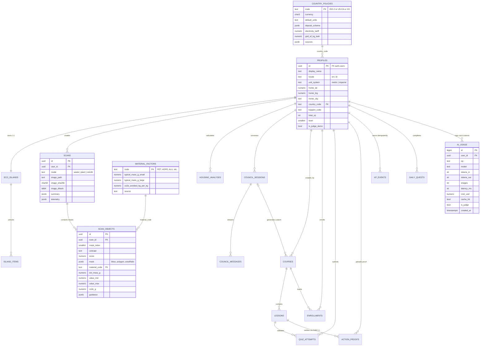

# 5. BSD — Backend Schema Documentation
**Project Name:** Verdara (*Spatial Intelligence for Sustainable Living & Resilient Homes*)  
**Database Engine:** Supabase PostgreSQL 16 + `postgis` + `pgcrypto`  
**Version:** 3.0 (Final Pre-Build Lock)  
**Date:** October 28, 2026

---

## 1. Entity-Relationship Diagram (ERD Lengkap — 18 Tabel)



*(Tabel sistem & cache tambahan tanpa FK user langsung: `ai_cache`, `geo_cache`, `rate_limits`, `active_streams` — diakses eksklusif oleh `service_role` di server).*

---

## 2. Skema SQL DDL Lengkap (`supabase/migrations/0001_verdara_schema.sql`)

```sql
-- ============================================================================
-- 1. EXTENSIONS
-- ============================================================================
create extension if not exists postgis;
create extension if not exists pgcrypto;

-- ============================================================================
-- 2. REFERENCE TABLES (COUNTRY POLICIES & EPA WARM MATERIAL FACTORS)
-- ============================================================================
create table public.country_policies (
  code               text primary key,              -- 'US', 'US-CA', 'DE', 'GB', 'JP', 'ID', ..., 'XX'
  name_en            text not null,
  name_id            text not null,
  currency           char(3) not null,              -- 'USD', 'EUR', 'GBP', 'JPY', 'IDR', ...
  default_units      text not null check (default_units in ('metric', 'imperial')),
  deposit_scheme     jsonb not null,                -- Skema CRV / Pfand / Bank Sampah / Municipal
  electricity_tariff numeric(12, 4) not null,       -- Harga listrik rumah tangga (mata uang lokal / kWh)
  grid_ef_kg_kwh     numeric(6, 4) not null,        -- Faktor emisi grid listrik (kg CO2e / kWh)
  sources            jsonb not null,                -- Sitasi URL & tanggal publikasi resmi
  updated_at         timestamptz not null default now()
);

create table public.material_factors (
  code                   text primary key,          -- 'PET','HDPE','PP','FILM','ALU','STEEL','GLASS','PAPER','CARDBOARD','ORGANIC','EWASTE','BATTERY','OTHER'
  category               text not null check (category in ('recyclable', 'organic', 'hazardous', 'residual')),
  typical_mass_g_small   numeric(8, 2) not null,
  typical_mass_g_large   numeric(8, 2) not null,
  co2e_avoided_kg_per_kg numeric(8, 4) not null,    -- Faktor US EPA WARM v16
  source                 text not null,
  as_of                  date not null
);

-- ============================================================================
-- 3. USER PROFILES & PURE-CODE 3D ECO-ISLAND STATE
-- ============================================================================
create table public.profiles (
  id                  uuid primary key references auth.users on delete cascade,
  display_name        text not null check (char_length(display_name) between 1 and 50),
  locale              text not null default 'en' check (locale in ('en', 'id')),
  unit_system         text not null default 'metric' check (unit_system in ('metric', 'imperial')),
  theme               text not null default 'system' check (theme in ('system', 'light', 'dark')),
  home_lat            numeric(5, 2),
  home_lng            numeric(6, 2),
  home_city           text,
  country_code        text references public.country_policies(code) default 'XX',
  koppen_code         text default 'Cfb',
  total_xp            integer not null default 0 check (total_xp >= 0),
  level               smallint not null default 1 check (level between 1 and 10),
  streak_days         integer not null default 1 check (streak_days >= 0),
  last_active_date    date default current_date,
  show_on_leaderboard boolean not null default false,
  is_judge_demo       boolean not null default false,
  created_at          timestamptz not null default now()
);

create table public.eco_islands (
  user_id    uuid primary key references public.profiles(id) on delete cascade,
  biome      text not null default 'temperate' check (biome in ('tropical', 'arid', 'temperate', 'mediterranean', 'continental', 'polar')),
  level      smallint not null default 1 check (level between 1 and 10),
  state      jsonb not null default '{"solarKwp": 0, "rainLitersYr": 0, "bioporeCount": 0, "treesCount": 2}',
  updated_at timestamptz not null default now()
);

create table public.island_items (
  id          uuid primary key default gen_random_uuid(),
  user_id     uuid not null references public.eco_islands(user_id) on delete cascade,
  item_code   text not null,                        -- 'solar_array', 'rain_cistern', 'compost_station', 'wind_turbine', dll.
  unlocked_by text not null,                        -- 'level:5' | 'lesson:<uuid>' | 'council:<uuid>'
  created_at  timestamptz not null default now(),
  unique (user_id, item_code)
);

-- ============================================================================
-- 4. OMNI-SPATIAL LENS (SCANS, SAM 3.1 OBJECTS, & ECO-RETROFITS)
-- ============================================================================
create table public.scans (
  id                 uuid primary key default gen_random_uuid(),
  user_id            uuid not null references public.profiles(id) on delete cascade,
  mode               text not null check (mode in ('waste', 'plant', 'retrofit')),
  image_path         text not null,
  retrofit_image_url text,                          -- URL hasil Muse Image / Muse Wonder (jika mode retrofit)
  image_sha256       char(64) not null,
  image_dhash        bit(64) not null,
  country_code       text not null,
  currency           char(3) not null,
  summary            jsonb not null,                -- { totalValueMin, totalValueMax, totalCo2eG, objectCount, plantSeverityPct }
  telemetry          jsonb not null,                -- { models, masksCount, latencyMs, tokensIn, tokensOut, costUsd, cache }
  created_at         timestamptz not null default now()
);
create index idx_scans_user_created on public.scans (user_id, created_at desc);
create index idx_scans_sha256 on public.scans (image_sha256, mode);

create table public.scan_objects (
  id            uuid primary key default gen_random_uuid(),
  scan_id       uuid not null references public.scans(id) on delete cascade,
  mask_index    smallint not null,
  concept       text not null,
  score         numeric(4, 3) not null,
  mask          jsonb not null,                     -- { bbox: [x,y,w,h], polygon: [[x,y],...], areaRatio: 0.045 }
  material_code text references public.material_factors(code),
  category      text not null check (category in ('recyclable', 'organic', 'hazardous', 'residual', 'plant_leaf', 'plant_lesion', 'retrofit_zone')),
  est_mass_g    numeric(8, 2),
  value_min     numeric(12, 4),
  value_max     numeric(12, 4),
  co2e_g        numeric(10, 2),
  guidance      jsonb                               -- { disposalInstruction, upcyclingRecipe: { title, steps[], tools[], safetyNote } }
);
create index idx_scan_objects_scan on public.scan_objects (scan_id);

-- ============================================================================
-- 5. GLOBAL 3D RADAR & HOUSING FOOTPRINT ANALYSES
-- ============================================================================
create table public.housing_analyses (
  id            uuid primary key default gen_random_uuid(),
  user_id       uuid not null references public.profiles(id) on delete cascade,
  location      geography(point, 4326) not null,
  city          text,
  country_code  text not null,
  koppen_code   text not null,
  footprint     jsonb,                              -- GeoJSON polygon atap bangunan
  footprint_m2  numeric(10, 2) not null,
  footprint_src text not null check (footprint_src in ('osm', 'manual')),
  inputs        jsonb not null,                     -- { usableRatio, panelDensity, perfRatio, runoffCoeff, filterEff, tariff }
  results       jsonb not null,                     -- { kwp, kwhYear, savingsYear, currency, co2eKgYear, rainLitersYear, biopores, tci }
  created_at    timestamptz not null default now()
);

-- ============================================================================
-- 6. THE VERDARA COUNCIL (MULTI-AGENT SESSIONS & MESSAGES)
-- ============================================================================
create table public.council_sessions (
  id         uuid primary key default gen_random_uuid(),
  user_id    uuid not null references public.profiles(id) on delete cascade,
  origin     text not null check (origin in ('radar', 'lens')),
  model_used text not null default 'muse-spark',
  site_brief jsonb not null,
  blueprint  jsonb,                                 -- ActionBlueprint JSON
  status     text not null default 'running' check (status in ('running', 'completed', 'failed')),
  created_at timestamptz not null default now()
);

create table public.council_messages (
  id         uuid primary key default gen_random_uuid(),
  session_id uuid not null references public.council_sessions(id) on delete cascade,
  agent      text not null check (agent in ('flora', 'arka', 'sirkula')),
  round      smallint not null default 1 check (round in (1, 2)),
  content    text not null,
  unverified jsonb not null default '[]',           -- Daftar angka yang tidak ada di site_brief
  created_at timestamptz not null default now()
);

-- ============================================================================
-- 7. VERIFIABLE FIELD-ACTION ACADEMY & SAM 3.1 PROOF-OF-ACTION
-- ============================================================================
create table public.courses (
  id              uuid primary key default gen_random_uuid(),
  slug            text unique not null,
  track           text not null check (track in ('zero_waste', 'urban_farming', 'passive_cooling', 'rainwater', 'custom')),
  title           jsonb not null,                   -- { en: "...", id: "..." }
  description     jsonb not null,                   -- { en: "...", id: "..." }
  is_ai_generated boolean not null default false,
  created_by      uuid references public.profiles(id) on delete cascade,
  source_session  uuid references public.council_sessions(id) on delete set null,
  created_at      timestamptz not null default now()
);

create table public.lessons (
  id                 uuid primary key default gen_random_uuid(),
  course_id          uuid not null references public.courses(id) on delete cascade,
  order_index        smallint not null,
  content            jsonb not null,                -- { en: {...}, id: {...}, climateVariants: { A: {...}, B: {...}, C: {...} } }
  quiz               jsonb not null,                -- 3 soal pilihan ganda
  proof_requirements jsonb not null,                -- [{ concept: "compost bin", minCount: 1, weight: 2, required: true }]
  unlocks_item_code  text,                          -- Item 3D yang dibuka di pulau saat lulus
  xp_reward          integer not null default 100 check (xp_reward between 10 and 300),
  unique (course_id, order_index)
);

create table public.enrollments (
  id           uuid primary key default gen_random_uuid(),
  user_id      uuid not null references public.profiles(id) on delete cascade,
  course_id    uuid not null references public.courses(id) on delete cascade,
  status       text not null default 'active' check (status in ('active', 'completed')),
  completed_at timestamptz,
  unique (user_id, course_id)
);

create table public.quiz_attempts (
  id         uuid primary key default gen_random_uuid(),
  user_id    uuid not null references public.profiles(id) on delete cascade,
  lesson_id  uuid not null references public.lessons(id) on delete cascade,
  correct    smallint not null,
  passed     boolean not null,
  created_at timestamptz not null default now()
);

create table public.action_proofs (
  id         uuid primary key default gen_random_uuid(),
  user_id    uuid not null references public.profiles(id) on delete cascade,
  lesson_id  uuid not null references public.lessons(id) on delete cascade,
  image_path text not null,
  dhash      bit(64) not null,                      -- 64-bit Perceptual Hash anti-cheat
  checklist  jsonb not null,                        -- Detail poligon & skor SAM 3.1 per konsep
  score      smallint not null check (score between 0 and 100),
  verified   boolean not null,
  created_at timestamptz not null default now()
);
create index idx_action_proofs_user on public.action_proofs (user_id, lesson_id);

-- ============================================================================
-- 8. GAMIFICATION, TELEMETRY, CACHING & 7-LAYER CREDIT SHIELD TABLES
-- ============================================================================
create table public.xp_events (
  id         uuid primary key default gen_random_uuid(),
  user_id    uuid not null references public.profiles(id) on delete cascade,
  source     text not null check (source in ('scan', 'proof', 'track', 'council', 'quest')),
  source_id  uuid not null,
  xp         integer not null check (xp >= 0),
  created_at timestamptz not null default now(),
  unique (user_id, source, source_id)
);

create table public.daily_quests (
  id         uuid primary key default gen_random_uuid(),
  user_id    uuid not null references public.profiles(id) on delete cascade,
  quest_date date not null default current_date,
  slot       smallint not null check (slot between 1 and 3),
  content    jsonb not null,
  done_at    timestamptz,
  unique (user_id, quest_date, slot)
);

create table public.ai_usage (
  id            bigint generated always as identity primary key,
  user_id       uuid references public.profiles(id) on delete set null,
  is_judge_demo boolean not null default false,
  op            text not null,                      -- 'detect_waste', 'sam_segment', 'enrich', 'eco_retrofit', 'council', 'voice'
  model         text not null,
  prompt_ver    text default 'v1.0',
  tokens_in     integer default 0,
  tokens_out    integer default 0,
  images        integer default 0,
  latency_ms    integer not null,
  cost_usd      numeric(10, 6) not null default 0,
  cache_hit     boolean not null default false,
  ok            boolean not null default true,
  error_code    text,
  created_at    timestamptz not null default now()
);
create index idx_ai_usage_created on public.ai_usage (created_at);
create index idx_ai_usage_user_op on public.ai_usage (user_id, op, created_at);

create table public.ai_cache (
  key        text primary key,                      -- 'lens:sha256:...' | 'sample:lens:01' | 'council:preset:sf'
  dhash      bit(64),
  mode       text,
  payload    jsonb not null,
  expires_at timestamptz not null
);

create table public.geo_cache (
  key        text primary key,                      -- 'era5:37.50:-122.25' | 'hubs:37.48:-122.15:PET'
  payload    jsonb not null,
  expires_at timestamptz not null
);

create table public.rate_limits (
  key          text primary key,                    -- 'ip:min:<hash>' | 'ip:hr:<hash>' | 'judge:ip:<hash>'
  window_start timestamptz not null,
  count        integer not null default 1
);

create table public.active_streams (
  lock_key   text primary key,                      -- 'user:<uid>' | 'ip:<hash>'
  op         text not null,
  expires_at timestamptz not null
);
```

---

## 3. Row-Level Security (RLS) & Atomic Security Definer RPCs

### 3.1 Kebijakan RLS
* **Tabel Publik (`SELECT` diizinkan untuk semua, `WRITE` dikunci ke `service_role`)**: `country_policies`, `material_factors`, `courses` (untuk `is_ai_generated = false`), `lessons`.
* **Tabel Milik Pengguna (`SELECT/INSERT/UPDATE` hanya jika `user_id = auth.uid()`)**: `profiles`, `scans`, `scan_objects`, `housing_analyses`, `council_sessions`, `council_messages`, `enrollments`, `quiz_attempts`, `action_proofs`, `daily_quests`.
* **Tabel Gamifikasi Read-Only Klien (`SELECT` oleh pemilik, `WRITE` hanya lewat fungsi `security definer`)**: `eco_islands`, `island_items`, `xp_events`.
* **Tabel Internal Credit Shield (`0 Policy` untuk klien — 100% hanya bisa diakses `service_role` di server)**: `ai_usage`, `ai_cache`, `geo_cache`, `rate_limits`, `active_streams`.

### 3.2 Fungsi Atomik PL/pgSQL (`check_ai_budget_shield` & `award_xp`)

```sql
-- Fungsi Atomik Pemeriksaan Anggaran & Judge Reserve Pool ($35)
create or replace function public.check_ai_budget_shield(
  p_user_id uuid,
  p_is_judge boolean,
  p_op text,
  p_daily_limit_usd numeric default 12.00,
  p_lifetime_cap_usd numeric default 135.00,
  p_judge_reserve_usd numeric default 35.00
)
returns jsonb
language plpgsql security definer set search_path = public as $$
declare
  v_today_spend numeric;
  v_total_spend numeric;
  v_user_op_today integer;
  v_user_quota integer;
  v_public_cap numeric := p_lifetime_cap_usd - p_judge_reserve_usd; -- $100.00 untuk publik
begin
  select coalesce(sum(cost_usd), 0) into v_today_spend
    from ai_usage where created_at >= date_trunc('day', now() at time zone 'utc');

  select coalesce(sum(cost_usd), 0) into v_total_spend from ai_usage;

  -- 1. Cek Lifetime Cap Total ($135 dari $150 kredit)
  if v_total_spend >= p_lifetime_cap_usd then
    return jsonb_build_object('allowed', false, 'reason', 'lifetime_cap_reached', 'fallback', 'eco_saver_cache');
  end if;

  -- 2. Cek Judge Reserve Pool ($35 eksklusif untuk akun juri)
  if (not p_is_judge) and (v_total_spend >= v_public_cap) then
    return jsonb_build_object('allowed', false, 'reason', 'judge_reserve_active', 'fallback', 'eco_saver_cache');
  end if;

  -- 3. Cek Batas Harian ($12 untuk publik, $18 untuk juri)
  if v_today_spend >= (case when p_is_judge then 18.00 else p_daily_limit_usd end) then
    return jsonb_build_object('allowed', false, 'reason', 'daily_budget_reached', 'fallback', 'eco_saver_cache');
  end if;

  -- 4. Cek Kuota Harian Per Operasi Per User
  select count(*) into v_user_op_today
    from ai_usage
   where user_id = p_user_id and op = p_op and cache_hit = false
     and created_at >= date_trunc('day', now() at time zone 'utc');

  v_user_quota := case
    when p_op = 'lens_scan'    then (case when p_is_judge then 40 else 15 end)
    when p_op = 'council'      then (case when p_is_judge then 15 else 5 end)
    when p_op = 'eco_retrofit' then (case when p_is_judge then 10 else 3 end)
    when p_op = 'proof_verify' then (case when p_is_judge then 25 else 10 end)
    else 20
  end;

  if v_user_op_today >= v_user_quota then
    return jsonb_build_object('allowed', false, 'reason', 'user_quota_exceeded', 'fallback', 'eco_saver_cache');
  end if;

  return jsonb_build_object('allowed', true, 'todaySpendUsd', v_today_spend, 'totalSpendUsd', v_total_spend);
end $$;
```

---

## 4. Spesifikasi Dataset Seed Awal (`supabase/seed.sql`)

### 4.1 12 Negara/Yurisdiksi di `country_policies` (+ Fallback Global `XX`)
| Kode | Mata Uang | Satuan | Tarif Listrik (`/kWh`) | Grid EF (`kg CO₂/kWh`) | Skema Deposit / Nilai Daur Ulang |
| :--- | :---: | :---: | :---: | :---: | :--- |
| **`US-CA`** | `USD` | `imperial` | `0.3200` | `0.2100` | **California CRV**: `< 24 oz` = `\$0.05`, `>= 24 oz` = `\$0.10` (`PET`, `HDPE`, `ALU`, `GLASS`) |
| **`US`** | `USD` | `imperial` | `0.1800` | `0.3700` | Scrap/Curbside municipal + buyback aluminium/kardus |
| **`DE`** | `EUR` | `metric` | `0.3700` | `0.3300` | **German DPG Pfand**: `EUR 0.25` sekali pakai (`PET`, `ALU`), `EUR 0.08–0.15` guna ulang |
| **`GB`** | `GBP` | `metric` | `0.2800` | `0.2000` | UK Council Curbside Recycling + Scrap Metal/Paper |
| **`FR`** | `EUR` | `metric` | `0.2500` | `0.0600` | Consigne / Tri Sélectif Perancis |
| **`JP`** | `JPY` | `metric` | `31.0000` | `0.4500` | Pemilahan ketat municipal Jepang (*Shigen Gomi*: PET, Kaleng, Kaca, Kardus) |
| **`KR`** | `KRW` | `metric` | `145.0000` | `0.4300` | Deposit botol Korea Selatan (`100–350 KRW`) + Volume-rate Jongnyangje |
| **`SG`** | `SGD` | `metric` | `0.3000` | `0.4000` | NEA Reverse Vending Machine (RVM) & Cash-for-Trash |
| **`AE`** | `AED` | `metric` | `0.3000` | `0.4200` | Tadweer / Bee'ah Smart RVM & Municipal Drop-off |
| **`AU`** | `AUD` | `metric` | `0.3300` | `0.5500` | **Container Deposit Scheme (CDS)**: `AUD 0.10` per botol/kaleng |
| **`ID`** | `IDR` | `metric` | `1445.0000` | `0.7800` | **Bank Sampah Indonesia** (Harga/kg: PET `Rp3.500–5.500`, Aluminium `Rp14.000–18.000`, Kardus `Rp2.000–3.200`) |
| **`BR`** | `BRL` | `metric` | `0.8500` | `0.0900` | Cooperativas de Catadores (PET, Aluminium, Kardus) |
| **`XX`** | `USD` | `metric` | `0.1600` | `0.4400` | Estimasi rata-rata global (Fallback untuk negara lainnya) |

### 4.2 13 Kode Material Tertutup di `material_factors` (US EPA WARM v16)
| Kode | Kategori | Massa Kecil (`g`) | Massa Besar (`g`) | $\text{CO}_2\text{e}$ Dihindari (`kg CO₂e / kg`) |
| :--- | :--- | :---: | :---: | :---: |
| **`PET`** | `recyclable` | `18` | `38` | `1.04` |
| **`HDPE`** | `recyclable` | `28` | `65` | `0.88` |
| **`PP`** | `recyclable` | `16` | `40` | `0.79` |
| **`FILM`** | `recyclable` | `6` | `18` | `0.72` |
| **`ALU`** | `recyclable` | `14` | `22` | `9.13` |
| **`STEEL`** | `recyclable` | `45` | `110` | `1.83` |
| **`GLASS`** | `recyclable` | `190` | `380` | `0.31` |
| **`PAPER`** | `recyclable` | `25` | `120` | `3.55` |
| **`CARDBOARD`** | `recyclable` | `140` | `420` | `3.14` |
| **`ORGANIC`** | `organic` | `85` | `300` | `0.58` |
| **`EWASTE`** | `hazardous` | `180` | `850` | `2.45` |
| **`BATTERY`** | `hazardous` | `24` | `95` | `1.90` |
| **`OTHER`** | `residual` | `30` | `100` | `0.00` |
